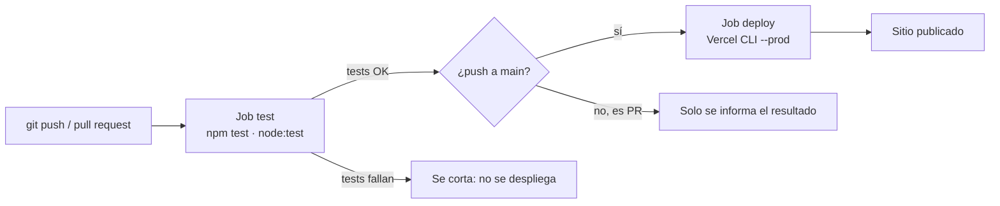

# CI/CD de Mola Eventos

Pipeline definido en `.github/workflows/ci-cd.yml`.



## Qué hace cada parte
- **CI (integración continua):** en cada push y pull request, GitHub Actions descarga el código, instala Node 22 y ejecuta `npm test`. Corre en Linux, igual que producción.
- **CD (despliegue continuo):** si el push es a `main` **y** los tests pasaron (`needs: test`), el job `deploy` publica en Vercel. Un test en rojo frena el despliegue.
- **Sin dependencias:** los tests usan solo `node:test` y `node:assert`, por eso el workflow no instala paquetes (más rápido y sin riesgo de cadena de suministro).
- **Mínimo privilegio:** `permissions: contents: read`; el token de Vercel vive en *Secrets*, nunca en el repositorio.

## Qué se testea
| Tipo | En este proyecto |
|---|---|
| Unitario | `filtros`, `pedido`, `cotizacion`, `validacion`, `whatsapp`, `datos` (funciones puras, sin DOM) |
| Integración (estática) | `integridad-sitio.test.js`: los JSON tienen la forma esperada y cada imagen, enlace, script y `url()` referenciado existe (con mayúsculas exactas) |
| E2E | No implementado. Se haría con Playwright o Cypress simulando un usuario real (agregar al carrito, completar el formulario). |

## Configuración (una sola vez)
1. En Vercel: *Add New → Project → Import* el repositorio de GitHub. Con `vercel.json` ya detecta que no hay build y que se publica la carpeta `src`.
2. Crear un token: *Vercel → Settings → Tokens → Create*.
3. Obtener los ids: en tu máquina, dentro del repo, `npx vercel link` y elegir el proyecto. Se crea `.vercel/project.json` con `orgId` y `projectId` (esa carpeta está en `.gitignore`).
4. En GitHub: *Settings → Secrets and variables → Actions → New repository secret*, cargar:
   - `VERCEL_TOKEN`
   - `VERCEL_ORG_ID`
   - `VERCEL_PROJECT_ID`
5. Hacer un push a `main` y mirar la pestaña **Actions**: dos jobs en verde (`test` y `deploy`).

> Si los secrets no están cargados, el job `deploy` termina en verde con una advertencia y no publica. Mientras tanto, la integración Git de Vercel sigue desplegando por su cuenta.
>
> **Opcional, recién cuando el deploy de Actions ande:** para que *solo* se publique si pasan los tests, desactivá los despliegues automáticos de Git agregando a `vercel.json` `"git": { "deploymentEnabled": false }`.

## Insignia (badge) para el README
Reemplazá `USUARIO/REPO`:

```

```

## Preguntas típicas de defensa
- **¿Por qué `needs: test`?** Para que el despliegue dependa de los tests: sin tests en verde no se publica.
- **¿Por qué no hay `npm install`?** Los tests solo usan módulos nativos de Node; instalar paquetes sumaría tiempo y superficie de ataque sin aportar nada.
- **¿Por qué testear funciones puras?** Reciben datos y devuelven datos, sin tocar `document` ni `localStorage`, así que se prueban en Node sin navegador.
- **¿Para qué el test de integridad?** Windows y macOS no distinguen mayúsculas en archivos y Linux (Vercel) sí: `Logo.png` funciona en tu PC y da 404 en producción. El test lo detecta antes de publicar.
- **¿Qué falta para E2E?** Un navegador automatizado (Playwright/Cypress) que recorra el flujo completo; es más lento y frágil, por eso se reserva para pocos casos críticos.
